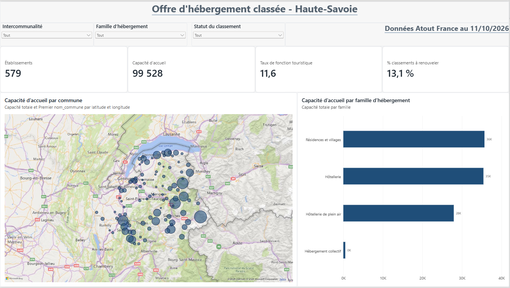
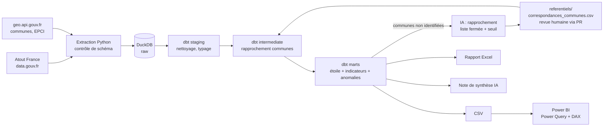

# Observatoire de l'offre d'hébergement touristique classée (Haute-Savoie)

Pipeline de données de bout en bout, de la donnée ouverte brute au tableau de bord Power BI et au reporting Excel
automatisé, avec des **contrôles qualité automatisés** et une **IA encadrée** pour fiabiliser les données.

> **Question métier** : où se concentre l'offre d'hébergement classée du département, quelles communes dépendent
> le plus du tourisme, quels hébergeurs doivent renouveler leur classement et quelle confiance accorder aux chiffres ?



---

## Ce que fait le projet

| Étape | Outil | Détail |
|---|---|---|
| **Extraction** | Python, `requests` | Hébergements classés [Atout France](https://www.data.gouv.fr/fr/datasets/hebergements-collectifs-classes-en-france/) (data.gouv.fr) et référentiel communes/EPCI ([geo.api.gouv.fr](https://geo.api.gouv.fr)). Archivage du fichier brut, contrôle du schéma source. |
| **Chargement** | DuckDB | Schéma `raw` non typé (approche ELT) et journal d'ingestion avec alerte de volumétrie. |
| **Transformation** | dbt | `staging`, puis `intermediate`, puis `marts` : modèle en étoile (1 fait, 3 dimensions) et marts d'indicateurs. |
| **Contrôles qualité** | dbt tests + mart d'anomalies | 32 tests dbt, 10 contrôles métier exposés dans une table d'anomalies, test de réconciliation des totaux. |
| **IA** | Claude (API Anthropic) | Rapprochement des communes fusionnées et rédaction automatique d'une note de synthèse, avec garde-fous et repli sans IA. |
| **Restitution** | Power BI, Excel | Rapport Power BI de 4 pages (Power Query, DAX) et rapport Excel mensuel mis en forme automatiquement. |
| **Automatisation** | GitHub Actions | Exécution mensuelle, publication des exports, pull request de revue pour les propositions de l'IA. |

## Architecture



## Démarrage rapide (Windows, PowerShell)

Prérequis : [Python 3.12](https://www.python.org/downloads/) et [Power BI Desktop](https://www.microsoft.com/fr-fr/download/details.aspx?id=58494).

```powershell
cd observatoire-tourisme-74
py -3.12 -m venv .venv
.venv\Scripts\Activate.ps1          # si refusé : Set-ExecutionPolicy -Scope CurrentUser RemoteSigned
pip install -r requirements.txt

python run_pipeline.py --demo       # données de démonstration, hors ligne (environ 10 s)
python run_pipeline.py              # données réelles Atout France + geo.api.gouv.fr
python run_pipeline.py --archive    # rejoue les derniers fichiers bruts téléchargés, sans internet
pytest                              # 24 tests : extraction, contrôles qualité, garde-fous IA
```

Pour activer l'IA, copie `.env.example` en `.env` et renseigne `ANTHROPIC_API_KEY`. Sans clé, tout fonctionne
avec des règles déterministes.

Sorties dans `data/exports/` : CSV pour Power BI (`powerbi/`), `Rapport_offre_classee_74_AAAA-MM.xlsx` et `synthese.md`.
Le rapport Power BI se construit en suivant [`powerbi/GUIDE_POWERBI.md`](powerbi/GUIDE_POWERBI.md).

Documentation et lignage dbt :

```powershell
cd dbt
$env:DUCKDB_PATH = "..\data\warehouse.duckdb"
dbt docs generate --profiles-dir . ; dbt docs serve --profiles-dir .
```

## Modèle de données

```
                     dim_date
                        │ date_classement
dim_commune ──── fct_hebergements_classes ──── dim_typologie
 (code_insee)           │ hebergement_id         (typologie → famille)
                        │
               mart_qualite_anomalies
```

- **`fct_hebergements_classes`** : un établissement classé par ligne (capacité, chambres, emplacements,
  étoiles, statut du classement, méthode de rapprochement de la commune).
- **`dim_commune`** : population, surface, coordonnées, intercommunalité, avec un membre « 99999 Commune non
  identifiée » pour qu'aucune ligne de fait ne pointe dans le vide.
- **`mart_indicateurs_communes`** : indicateurs prêts à l'emploi, dont le **taux de fonction touristique**
  (lits classés pour 100 habitants).

## Contrôles qualité

Deux niveaux complémentaires :

1. **Tests dbt** (intégrité structurelle, bloquants) : unicité et non-nullité des clés, intégrité référentielle
   faits/dimensions, valeurs autorisées, intervalles, et un **test de réconciliation** qui vérifie que la capacité
   totale est identique dans la table de faits et dans les agrégats communaux.
2. **Table d'anomalies `mart_qualite_anomalies`** (contrôles métier, à traiter au cas par cas), exploitée dans
   Power BI et dans Excel :

| Contrôle | Sévérité | Exemple |
|---|---|---|
| Commune non rapprochée | Bloquante | Libellé sans correspondance INSEE : la capacité n'est attribuée à aucune commune |
| Capacité manquante | Bloquante | Établissement sans capacité d'accueil |
| Date de classement future | Bloquante | Erreur de saisie |
| Ratio capacité / chambre incohérent | Avertissement | 400 personnes pour 10 chambres |
| Ratio capacité / emplacement incohérent | Avertissement | Camping hors de 1 à 8 personnes par emplacement |
| Unité d'offre manquante | Avertissement | Hôtel sans nombre de chambres |
| Doublon dans la source | Avertissement | Ligne présente deux fois dans le fichier |
| Rapprochement indirect | Info | Commune déduite du seul code postal |
| Classement expiré | Info | Classement de plus de 5 ans non prorogé |
| Site internet invalide | Info | URL mal formée (espace, domaine incomplet) ; un protocole manquant est simplement complété |

S'y ajoutent le **contrôle de schéma** à l'extraction (arrêt explicite si Atout France renomme une colonne) et le
**contrôle de volumétrie** au chargement (alerte si le nombre de lignes chute de plus de 20 %).

## L'IA dans le pipeline, et ses garde-fous

**Le problème** : la source contient un libellé de commune saisi librement. Les communes fusionnées (Seynod et
Annecy-le-Vieux devenues Annecy en 2017, Montmin et Talloires devenues Talloires-Montmin en 2016) ne correspondent à
aucune commune actuelle, et leur offre disparaît des indicateurs communaux.

**La démarche** :
1. dbt applique d'abord **4 règles déterministes**, de la plus fiable à la moins fiable (table de correspondance,
   code postal + nom, nom seul, code postal unique) ;
2. les cas restants sont soumis au modèle de langage avec une **liste fermée de communes candidates** ;
3. **garde-fous** : un code INSEE hors référentiel est rejeté, une proposition sous le seuil de confiance (0,85) est
   tracée mais non appliquée, et une panne de l'API déclenche un repli sur la similarité de chaînes (`rapidfuzz`) ;
4. les propositions sont écrites dans `referentiels/correspondances_communes.csv`, **versionné dans Git** : en
   automatique, GitHub Actions ouvre une pull request et **un humain valide** avant que la correspondance ne
   devienne définitive.

La **note de synthèse** suit le même principe : l'IA ne reçoit que les indicateurs calculés par le pipeline et a pour
consigne de n'en inventer aucun. Sans clé API, un texte modèle déterministe est produit.

Ces garde-fous sont couverts par des tests (`tests/test_ia.py`) qui simulent une hallucination et une panne d'API.

## Structure du dépôt

```
├── run_pipeline.py              # orchestration des 5 étapes
├── src/
│   ├── extract/                 # Atout France, geo.api.gouv.fr
│   ├── load.py                  # DuckDB + journal d'ingestion
│   ├── ai/                      # rapprochement des communes, note de synthèse
│   └── reporting/exports.py     # CSV Power BI + rapport Excel
├── dbt/
│   ├── models/staging/          # nettoyage, typage, dédoublonnage
│   ├── models/intermediate/     # rapprochement des communes
│   ├── models/marts/            # étoile, indicateurs, anomalies
│   ├── macros/                  # normalisation des noms de communes, etc.
│   └── tests/                   # test générique d'intervalle, test de réconciliation
├── referentiels/                # correspondances de communes (revue humaine)
├── powerbi/                     # guide, requêtes Power Query, mesures DAX, thème
├── tests/                       # pytest + données de démonstration
└── .github/workflows/           # exécution mensuelle
```

## Limites et pistes d'évolution

- **Périmètre** : l'offre classée uniquement. Les meublés de tourisme et les résidences secondaires, qui pèsent lourd
  en montagne, n'y figurent pas. Le taux de fonction touristique calculé ici est donc un minorant.
- **Fréquentation** : croiser l'offre avec la demande (nuitées INSEE, taxe de séjour, données de téléphonie mobile)
  pour calculer des taux d'occupation.
- **Enrichissement** : la base nationale DATAtourisme (points d'intérêt, événements) et la météo (Open-Meteo) pour
  expliquer la saisonnalité.
- **Industrialisation** : orchestration Airflow (voir mon projet
  [pipeline météo et énergie](https://github.com/Hamouzz)), entrepôt PostgreSQL, publication sur le service Power BI
  avec actualisation planifiée.

---
*Données : Atout France (hébergements classés), Licence Ouverte ; geo.api.gouv.fr (API Découpage administratif).
Les données de démonstration de `tests/fixtures/` sont fictives.*
